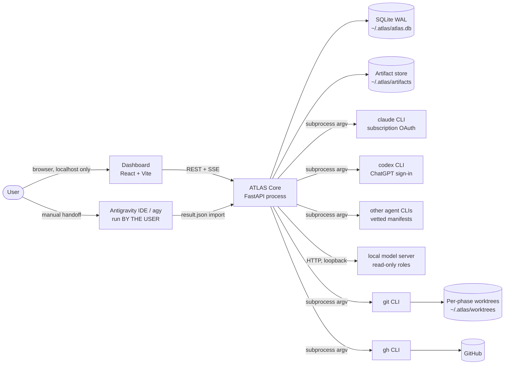
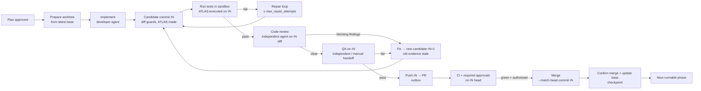

# ATLAS Architecture

Status: Phase 0 draft (portability amendment, ADR-007) · Date: 2026-10-22 · Owner: Lead architect (Claude Code), challenger: Codex

## 1. Goals and non-goals

**Goals**
- Turn a high-level software request into a phased, dependency-ordered plan. Execute it one phase at a time, through gated stages: plan, challenge, implement, test, review, QA, commit, PR, merge, checkpoint.
- Use only official agent interfaces from a user-configured registry (ADR-007): subscription CLIs, local/open-weight models through agent CLIs or a loopback OpenAI-compatible endpoint, or an explicitly opted-in API key. Never touch subscription credentials that CLIs manage.
- Be portable: anyone can self-host ATLAS on macOS or Linux with the agents they have (D13).
- Survive crashes, restarts and quota exhaustion without duplicating external side effects.
- Isolate projects from each other: repo, config, queue, state, worktrees, agent context.
- Never report an action that did not happen.

**Non-goals (first release)**
- Hosting ATLAS for other people. ATLAS is self-hosted and single-operator: each person runs their own copy with their own accounts (ADR-004, ADR-007).
- Native Windows (WSL2 may come later, D13).
- Running several code-changing phases in one repository at the same time.
- Production deployment. ATLAS stops at "merged + verified CI". Deployment verification is a pluggable, opt-in hook.
- Automating Google Antigravity (ADR-003).

## 2. Context diagram



The agents shown are the recommended profile; the user's registry decides which exist (ADR-007). ATLAS never runs `agy`. The user does, and imports the result (see [antigravity-manual-handoff.md](antigravity-manual-handoff.md)).

## 3. Process model

A single Python 3.12 process (`atlas serve`) contains:

| Component | Responsibility |
|---|---|
| **API layer** (FastAPI) | REST endpoints and SSE event stream for the dashboard. Binds to `127.0.0.1` only and requires a per-install session token. |
| **Workflow engine (LangGraph)** | Runs the task and phase graphs with durable SQLite checkpoints (`~/.atlas/graph.db`, `durability="sync"`), retries, and `interrupt()` pauses for approvals, CI waits and manual handoffs. It holds *where execution is*, never *what is true*. See [ADR-006](adr/ADR-006-langgraph-engine.md). |
| **Orchestrator** | The only component allowed to change workflow state. Graph nodes call it to apply validated FSM transitions inside app-DB transactions, and graph routing functions call the policy engine. Reads gate policy from config, never from agent output. |
| **Scheduler** | Chooses the next runnable phase across projects: priority, dependency satisfaction, repo lock, agent capacity. Default concurrency is one code-changing phase per repo and one global agent invocation per registry agent. |
| **Supervisor** | asyncio task that spawns and monitors subprocesses: agents, git, gh, test commands. Records PID, process start time, process group, and stdout/stderr artifact files. Enforces timeouts and sends SIGINT → SIGTERM → SIGKILL in that order. |
| **Agent adapters** | One per registry agent, built from a vetted adapter manifest (ADR-007 §3). Build an argv from a vetted template, parse output into typed results, and classify failures into capacity states. Never interpret agent text as instructions to ATLAS. |
| **Capacity manager** | Tracks per-agent state (AVAILABLE, BUSY, RATE_LIMITED, QUOTA_EXHAUSTED, AUTHENTICATION_REQUIRED, PROVIDER_UNAVAILABLE, UNKNOWN, MANUAL_ONLY). Runs bounded backoff and cheap auth probes. |
| **Repository service** | Clone, fetch, worktree add/remove, branch, diff, commit, reconciliation. Wraps git only; it is not an agent. |
| **GitHub service** | Wraps `gh` for PR, checks, reviews and merge. Every mutating call goes through the outbox (see [recovery-strategy.md](recovery-strategy.md)). |
| **Test runner** | Runs project-configured test commands at the candidate commit, **inside the enforced test sandbox** (security-model.md §5.1; fails closed if unavailable), and captures structured results. These are the *executed* results, distinct from what an agent reports. |
| **Policy engine** | Pure functions. Given the config, the phase and the evidence, it answers questions such as "may we merge?" and "is the reviewer independent?". Fully unit-tested. |
| **Handoff service** | Creates and validates manual-handoff packets: Antigravity, and any step where an agent is unavailable. |
| **Recovery service** | Runs at startup before the scheduler. Reconciles DB state against git, GitHub and processes. |
| **Audit/log** | Structured JSON logs with correlation IDs, an append-only `transitions` table and `audit_log` table, and secret redaction. |

There is no Redis, broker or Postgres. A single process with SQLite is enough at this scale (ADR-002). LangGraph runs in-process as a library (ADR-001, ADR-006). `launchd` (macOS) or a `systemd --user` unit (Linux) keeps it running (Phase 10).

## 4. Data and directory layout

```
~/.atlas/
  atlas.db                 # SQLite WAL app DB: the source of truth (global + per-project rows, project_id FK everywhere)
  graph.db                 # LangGraph checkpoints: execution position only (0600, never readable by sandboxes)
  config.yaml              # global config (non-secret)
  agents.yaml              # agent registry (non-secret; ADR-007 §2)
  projects/<project_id>/
    project.yaml           # project config (copied from user input; repo copy is NOT trusted)
    repo/                  # primary clone (never edited directly; base for worktrees)
  worktrees/<project_id>/<phase_id>/   # developer worktree, one per active phase (agents only; never used for evidence)
  sandboxes/<execution_id>/            # per run: QA verification worktree (wt/) or the extracted, validated /out of a test container (nothing on the host is mounted into the sandbox VM)
  snapshots/<execution_id>/            # preserved index/worktree state before any reset
  run/<execution_id>.json              # launcher run files (process discovery)
  artifacts/<sha256>       # content-addressed blobs: prompts, agent output, diffs, logs, test reports
  handoffs/<project_id>/<execution_id>/  # manual handoff packets
  logs/atlas.jsonl
```

Secrets are kept outside this tree. Phase 1+ stores ATLAS-managed secrets in the OS secret store through the `SecretStore` interface (macOS Keychain, Linux Secret Service; ADR-007 §6):
- the per-project GitHub PAT under `atlas.<project_id>.github`;
- API keys for agents the user set to `billing: api_key` under `atlas.agent.<agent_id>` (D15).

## 5. The delivery pipeline (per phase)



All evidence is bound to an immutable **candidate commit**, never to uncommitted worktree state. See [workflow-state-machine.md §0](workflow-state-machine.md). Gates are enforced by the policy engine. Any gate that cannot be satisfied because of missing evidence, capacity or a manual step moves the phase to `BLOCKED`, `AWAITING_MANUAL` or `AWAITING_APPROVAL`. The phase never moves forward without that evidence.

## 6. Evidence model

Every claim shown in the UI or in a report is labelled with its provenance:

| Label | Meaning | Example |
|---|---|---|
| `executed` | ATLAS ran it and captured exit code and output | `pytest` run by the test runner |
| `remote_verified` | ATLAS read it back from GitHub | PR merged, `mergeCommit` SHA |
| `agent_reported` | An agent said so (headless run, output parsed) | "I added tests for X" |
| `manual_imported` | Imported from a user-run handoff | Antigravity QA result |
| `proposed` | Suggested but not executed | "Run Playwright test Y" |

Gates accept only `executed` or `remote_verified` evidence for tests, CI and merge. Review and QA *findings* may be `agent_reported` or `manual_imported`. But a *fix* to a finding is accepted only when an independent reviewer re-checks it and the tests are re-executed.

## 7. Trust boundaries

1. **User ↔ ATLAS.** Trusted. Localhost UI with a token.
2. **ATLAS ↔ agents.** Only CLIs with a `verified` manifest are launched, and they are trusted as published. Local model servers are trusted only to return text. Their *output* is untrusted data. Agents run with cwd set to the phase worktree, with a scrubbed env (no `GH_TOKEN`, no ATLAS secrets) and restrictive permission flags.
3. **ATLAS ↔ repository content.** Untrusted. This includes READMEs, `AGENTS.md`/`CLAUDE.md`, `.claude/`, `.codex/`, `.mcp.json`, issues, CI logs and PR comments. ATLAS policy never comes from repo content (see [security-model.md](security-model.md)).
4. **ATLAS ↔ GitHub.** Authenticated through gh. Mutations are idempotent and reconciled.
5. **Project ↔ project.** Separate rows, worktrees, artifact references and handoff dirs. Agent invocations receive only the current project's worktree.

## 8. Configuration

Config is layered: built-in safe defaults → `~/.atlas/config.yaml` → `~/.atlas/projects/<id>/project.yaml` → per-task overrides (only fields marked overridable). A repository may *suggest* config, for example an `atlas.yaml` in the repo. ATLAS shows it as a proposal and applies it only after the user accepts it in the UI, because repo content is untrusted. Schema validation uses Pydantic, and unknown keys are rejected.

Safe defaults (must hold with an empty config):

```yaml
execution:  { mode: supervised,   # only value accepted in this release (D7)
              max_active_phases_per_repository: 1, max_review_cycles: 3, max_repair_attempts: 3 }
git:        { use_worktrees: true, create_pull_requests: true, auto_merge: false, merge_strategy: squash }  # auto_merge: true rejected (D6)
quality:    { require_tests: true, require_code_review: true, require_independent_qa: true,
              block_on_critical_findings: true, block_on_high_findings: true }
capacity:   { on_quota_exhausted: pause, allow_agent_substitution: false,
              allow_paid_api_fallback: false, allow_unsupported_integrations: false }   # api_key billing is a per-agent choice, never a fallback (D15)
safety:     { allow_direct_main_changes: false, allow_force_push: false, allow_secret_modification: false,
              allow_destructive_database_commands: false, allow_production_deployment: false }
agents:     { architect: claude, challenger: codex, developer: codex, reviewer: claude, qa: antigravity }  # registry ids from ~/.atlas/agents.yaml (ADR-007)
```

`allow_paid_api_fallback` and `allow_unsupported_integrations` cannot be set to `true` in this release. The schema rejects it.

## 9. Agent role matrix and independence

Roles point at agents in the user's registry (ADR-007 §2). The table below is the **recommended profile** for someone with Claude, Codex and Antigravity, not a built-in rule. Whatever profile is used, the policy engine enforces **ADR-005**:
- The reviewer, challenger and QA agent for an artifact must differ from its author at both the *provider* level and the *model family* level.
- Example: Antigravity running a Claude model may not review Claude-authored work. The declared model is recorded at import.
- If independence cannot be satisfied with the available agents, the step goes to `AWAITING_MANUAL`. It is never silently fulfilled by the author.

| Role | Recommended | Allowed fallback (only if `allow_agent_substitution: true`) |
|---|---|---|
| architect / planner | claude | codex |
| plan challenger | codex | claude (only if plan author ≠ claude) |
| developer | codex | claude |
| code reviewer | claude | codex (only if developer ≠ codex) |
| QA | antigravity (manual handoff; any configured QA or `manual_handoff` agent works) | none: wait for the manual handoff (D4) |

## 10. Technology choices

Platforms: macOS and Linux (D13). Platform-specific code sits behind `SecretStore`, `TestSandbox`, `AgentBoundary` and service-manager interfaces (ADR-007 §6).
Backend: Python 3.12, FastAPI, Pydantic v2, **LangGraph + langgraph-checkpoint-sqlite** (workflow engine; no LangSmith/Platform/model integrations), SQLAlchemy 2.x + Alembic, SQLite WAL, asyncio subprocess, `structlog`.
Frontend: React + TypeScript + Vite + Tailwind.
Tests: pytest (+ pytest-asyncio, hypothesis for FSM properties), Vitest, Playwright.
Packaging: `uv` with a lockfile for Python and `npm ci` with a lockfile for the frontend. `pip-audit` and `npm audit` run in CI.
The rationale and the evaluation of off-the-shelf orchestrators are in [ADR-001](adr/ADR-001-build-vs-adopt.md).

## 11. Cross-references
- Agents: [agent-compatibility.md](agent-compatibility.md)
- States: [workflow-state-machine.md](workflow-state-machine.md)
- Schema: [database-design.md](database-design.md)
- Recovery: [recovery-strategy.md](recovery-strategy.md)
- GitHub: [github-integration.md](github-integration.md)
- Security: [security-model.md](security-model.md)
- Plan: [implementation-roadmap.md](implementation-roadmap.md)
