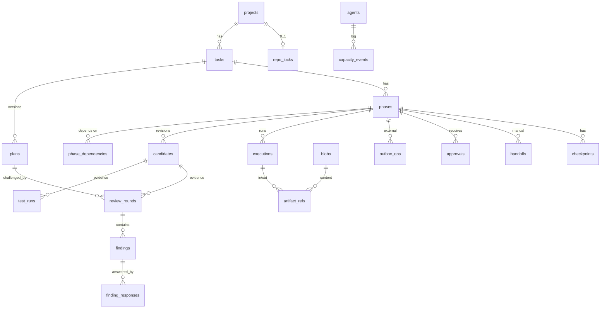

# Database Design

Status: Phase 0, revision 2 (after Codex review round 1) · 2026-10-22

## 1. Engine settings
- SQLite 3, one file at `~/.atlas/atlas.db`, mode 0600, directory 0700.
- Pragmas on every connection: `journal_mode=WAL`, `synchronous=FULL`, `foreign_keys=ON`, `busy_timeout=5000`.
- Single writer: all writes go through one async write queue using `BEGIN IMMEDIATE`. Reads use a separate pool.
- SQLAlchemy 2.x + Alembic. Before each migration, ATLAS makes a backup with the SQLite online backup API. A daily backup is also kept. All backups are quiesced and paired with `graph.db` (§5).
- IDs are ULIDs stored as TEXT. Timestamps are UTC ISO-8601 TEXT. JSON columns are TEXT, validated by Pydantic.
- Large content lives in a content-addressed blob store. The DB holds references.

## 2. Ownership model (ATLAS-014)
Every project-scoped parent table declares `UNIQUE(id, project_id)`. Every child references the parent with a **composite foreign key** `(parent_id, project_id)`. As a result, a phase cannot point at a task from another project, evidence cannot point at another project's execution, and so on. Polymorphic references (`subject_type/subject_id`) are validated in the same transaction by the repository layer, with negative tests.



## 3. Tables

```sql
CREATE TABLE projects (
  id TEXT PRIMARY KEY, name TEXT UNIQUE NOT NULL,
  github_repo TEXT NOT NULL UNIQUE,            -- canonical lowercase owner/name; one registration per repo (ATLAS-012)
  visibility TEXT NOT NULL CHECK (visibility IN ('private','public','internal')),
  base_branch TEXT NOT NULL DEFAULT 'main',
  protection_status TEXT NOT NULL DEFAULT 'unknown' CHECK (protection_status IN ('known','user_declared','unknown')),
  protection_json TEXT, merge_queue INTEGER NOT NULL DEFAULT 0,
  clone_path TEXT NOT NULL, config_json TEXT NOT NULL, policy_version INTEGER NOT NULL DEFAULT 1,
  detected_stack_json TEXT, status TEXT NOT NULL DEFAULT 'active',
  created_at TEXT NOT NULL, updated_at TEXT NOT NULL
);

CREATE TABLE tasks (
  id TEXT PRIMARY KEY, project_id TEXT NOT NULL REFERENCES projects(id),
  title TEXT NOT NULL, request_text TEXT NOT NULL, category TEXT NOT NULL,
  priority INTEGER NOT NULL DEFAULT 3, autonomy TEXT NOT NULL DEFAULT 'supervised',
  acceptance_criteria_json TEXT NOT NULL,
  state TEXT NOT NULL, resume_to TEXT, blocked_reason TEXT, current_plan_id TEXT,
  version INTEGER NOT NULL DEFAULT 0, created_at TEXT NOT NULL, updated_at TEXT NOT NULL,
  UNIQUE (id, project_id)
);

CREATE TABLE plans (
  id TEXT PRIMARY KEY, project_id TEXT NOT NULL, task_id TEXT NOT NULL,
  revision INTEGER NOT NULL, author_agent TEXT NOT NULL, author_model TEXT,
  base_sha TEXT NOT NULL, plan_blob TEXT NOT NULL REFERENCES blobs(sha256),
  status TEXT NOT NULL,                        -- draft|challenged|approved|superseded
  created_at TEXT NOT NULL,
  UNIQUE (task_id, revision), UNIQUE (id, project_id), UNIQUE (id, task_id, project_id),
  FOREIGN KEY (task_id, project_id) REFERENCES tasks(id, project_id)
);

CREATE TABLE phases (
  id TEXT PRIMARY KEY, project_id TEXT NOT NULL, task_id TEXT NOT NULL, plan_id TEXT NOT NULL,
  seq INTEGER NOT NULL, kind TEXT NOT NULL DEFAULT 'change' CHECK (kind IN ('change','revert')),
  reverts_phase_id TEXT,
  title TEXT NOT NULL, objective TEXT NOT NULL,
  spec_json TEXT NOT NULL,                     -- affected_files, acceptance_criteria[{id,text,mandatory}], required_tests, risk_level, rollback_strategy, estimated_complexity, tags
  state TEXT NOT NULL, resume_to TEXT, blocked_reason TEXT,
  branch TEXT, worktree_path TEXT, base_sha TEXT,
  current_candidate_id TEXT,                   -- FK enforced by trigger (circular reference)
  pr_number INTEGER, merge_commit_sha TEXT,
  repair_attempts INTEGER NOT NULL DEFAULT 0, review_cycles INTEGER NOT NULL DEFAULT 0,
  version INTEGER NOT NULL DEFAULT 0, created_at TEXT NOT NULL, updated_at TEXT NOT NULL,
  UNIQUE (plan_id, seq), UNIQUE (id, project_id), UNIQUE (id, task_id, project_id),
  FOREIGN KEY (task_id, project_id) REFERENCES tasks(id, project_id),
  FOREIGN KEY (plan_id, task_id, project_id) REFERENCES plans(id, task_id, project_id),  -- plan belongs to the same task
  FOREIGN KEY (reverts_phase_id, project_id) REFERENCES phases(id, project_id)
);

CREATE TABLE phase_dependencies (
  project_id TEXT NOT NULL, phase_id TEXT NOT NULL, depends_on TEXT NOT NULL,
  PRIMARY KEY (phase_id, depends_on), CHECK (phase_id <> depends_on),
  FOREIGN KEY (phase_id, project_id) REFERENCES phases(id, project_id),
  FOREIGN KEY (depends_on, project_id) REFERENCES phases(id, project_id)
);  -- same-task + acyclicity validated on plan approval

CREATE TABLE candidates (                       -- immutable evidence anchor (ATLAS-001)
  id TEXT PRIMARY KEY, project_id TEXT NOT NULL, phase_id TEXT NOT NULL,
  revision INTEGER NOT NULL, commit_sha TEXT NOT NULL, tree_sha TEXT NOT NULL, parent_sha TEXT NOT NULL,
  author_agent TEXT NOT NULL, author_model TEXT, created_by_execution TEXT,
  guard_status TEXT NOT NULL CHECK (guard_status IN ('clear','held')),   -- derived: held iff any candidate_guard_violations row (ATLAS-102/201)
  guard_report_ref TEXT,
  created_at TEXT NOT NULL,
  UNIQUE (phase_id, revision), UNIQUE (phase_id, commit_sha), UNIQUE (id, project_id),
  UNIQUE (id, phase_id, project_id),
  FOREIGN KEY (phase_id, project_id) REFERENCES phases(id, project_id)
);

CREATE TABLE candidate_guard_violations (       -- complete set of diff-guard violations (ATLAS-201)
  id TEXT PRIMARY KEY, project_id TEXT NOT NULL, candidate_id TEXT NOT NULL,
  kind TEXT NOT NULL CHECK (kind IN ('protected_path','secret_change','destructive_migration')),
  path TEXT, detail TEXT NOT NULL,
  FOREIGN KEY (candidate_id, project_id) REFERENCES candidates(id, project_id)
);

CREATE TABLE repo_locks (                       -- one active code-changing phase per repository
  project_id TEXT PRIMARY KEY REFERENCES projects(id),   -- 1:1 with repository because github_repo is UNIQUE
  phase_id TEXT NOT NULL, acquired_at TEXT NOT NULL, holder_instance TEXT NOT NULL,
  FOREIGN KEY (phase_id, project_id) REFERENCES phases(id, project_id)
);

CREATE TABLE agents (
  id TEXT PRIMARY KEY, integration_mode TEXT NOT NULL,   -- headless|manual_handoff|blocked
  cli_version TEXT, help_hash TEXT, capabilities_json TEXT NOT NULL,
  auth_status TEXT NOT NULL, capacity_state TEXT NOT NULL, capacity_reason TEXT,
  next_probe_at TEXT, last_success_at TEXT, updated_at TEXT NOT NULL
);
CREATE TABLE capacity_events (
  id TEXT PRIMARY KEY, agent_id TEXT NOT NULL REFERENCES agents(id),
  from_state TEXT, to_state TEXT NOT NULL, signal TEXT NOT NULL, execution_id TEXT, at TEXT NOT NULL
);

CREATE TABLE executions (
  id TEXT PRIMARY KEY, project_id TEXT NOT NULL, task_id TEXT NOT NULL, phase_id TEXT, candidate_id TEXT,
  kind TEXT NOT NULL CHECK (kind IN ('agent','test','git','gh')),
  agent_id TEXT REFERENCES agents(id), role TEXT, model TEXT,
  status TEXT NOT NULL, retry_count INTEGER NOT NULL DEFAULT 0,
  git_sha TEXT, argv_json TEXT NOT NULL,       -- redacted
  pid INTEGER, pgid INTEGER, pid_start_time TEXT, run_file TEXT, provider_session_id TEXT,
  exit_code INTEGER, error_class TEXT, error_detail TEXT, capacity_signal TEXT,
  instance_generation INTEGER,
  correlation_id TEXT NOT NULL, started_at TEXT, finished_at TEXT, created_at TEXT NOT NULL,
  UNIQUE (id, project_id), UNIQUE (id, candidate_id, project_id),
  FOREIGN KEY (task_id, project_id) REFERENCES tasks(id, project_id),
  FOREIGN KEY (phase_id, task_id, project_id) REFERENCES phases(id, task_id, project_id),
  FOREIGN KEY (candidate_id, phase_id, project_id) REFERENCES candidates(id, phase_id, project_id)
);
CREATE INDEX ix_exec_live ON executions(status) WHERE status IN ('launching','running');

-- Content-addressed storage split from ownership (ATLAS-013)
CREATE TABLE blobs (
  sha256 TEXT PRIMARY KEY, size INTEGER NOT NULL, media_type TEXT NOT NULL,
  redacted INTEGER NOT NULL DEFAULT 1, created_at TEXT NOT NULL
);
CREATE TABLE artifact_refs (
  id TEXT PRIMARY KEY, project_id TEXT NOT NULL REFERENCES projects(id),
  sha256 TEXT NOT NULL REFERENCES blobs(sha256),
  kind TEXT NOT NULL,                          -- prompt|agent_output|diff|log|test_report|plan|review|handoff_packet|handoff_result|snapshot_manifest
  execution_id TEXT, direction TEXT CHECK (direction IN ('in','out')), created_at TEXT NOT NULL,
  UNIQUE (id, project_id),
  FOREIGN KEY (execution_id, project_id) REFERENCES executions(id, project_id)
);  -- reads authorise via artifact_refs.project_id, never via blob hash alone

CREATE TABLE test_runs (
  id TEXT PRIMARY KEY, project_id TEXT NOT NULL, phase_id TEXT NOT NULL, candidate_id TEXT NOT NULL,
  execution_id TEXT, command TEXT NOT NULL, exit_code INTEGER, passed INTEGER, failed INTEGER, skipped INTEGER,
  evidence TEXT NOT NULL CHECK (evidence IN ('executed','manual_imported','agent_reported')),
  integrity TEXT NOT NULL CHECK (integrity IN ('verified','invalid_source_mutated','not_checked')),
  report_ref TEXT, created_at TEXT NOT NULL,
  FOREIGN KEY (candidate_id, phase_id, project_id) REFERENCES candidates(id, phase_id, project_id),
  FOREIGN KEY (execution_id, candidate_id, project_id) REFERENCES executions(id, candidate_id, project_id),
  CHECK (evidence <> 'executed' OR (execution_id IS NOT NULL AND integrity <> 'not_checked'))
);

CREATE TABLE review_rounds (
  id TEXT PRIMARY KEY, project_id TEXT NOT NULL,
  subject_type TEXT NOT NULL CHECK (subject_type IN ('plan','candidate')),
  plan_id TEXT, candidate_id TEXT,
  kind TEXT NOT NULL,                          -- plan_challenge|code_review|qa|fix_verification
  reviewer_agent TEXT NOT NULL, reviewer_model TEXT, author_agent TEXT NOT NULL, author_model TEXT,
  verdict TEXT NOT NULL, evidence TEXT NOT NULL CHECK (evidence IN ('agent_reported','manual_imported')),
  criteria_json TEXT,                          -- QA: per-criterion status (validated complete; ATLAS-015)
  execution_id TEXT, cycle INTEGER NOT NULL, created_at TEXT NOT NULL,
  UNIQUE (id, project_id),
  CHECK ((subject_type='plan' AND plan_id IS NOT NULL AND candidate_id IS NULL)
      OR (subject_type='candidate' AND candidate_id IS NOT NULL AND plan_id IS NULL)),
  FOREIGN KEY (plan_id, project_id) REFERENCES plans(id, project_id),
  FOREIGN KEY (candidate_id, project_id) REFERENCES candidates(id, project_id),
  FOREIGN KEY (execution_id, candidate_id, project_id) REFERENCES executions(id, candidate_id, project_id)
    -- candidate reviews: execution must be for the SAME candidate (ATLAS-014 r3).
    -- plan reviews (candidate_id NULL): validator requires execution.task_id = plan.task_id AND execution.candidate_id IS NULL
);

CREATE TABLE findings (
  id TEXT PRIMARY KEY, project_id TEXT NOT NULL, review_round_id TEXT NOT NULL,
  severity TEXT NOT NULL CHECK (severity IN ('CRITICAL','HIGH','MEDIUM','LOW','INFORMATIONAL')),
  category TEXT NOT NULL, file TEXT, location TEXT, description TEXT NOT NULL,
  evidence TEXT NOT NULL, recommendation TEXT,
  status TEXT NOT NULL DEFAULT 'open',         -- open|accepted|rejected|fixed_unverified|verified_fixed|waived
  fingerprint TEXT NOT NULL, created_at TEXT NOT NULL, updated_at TEXT NOT NULL,
  UNIQUE (id, project_id),
  FOREIGN KEY (review_round_id, project_id) REFERENCES review_rounds(id, project_id)
);
CREATE TABLE finding_responses (
  id TEXT PRIMARY KEY, project_id TEXT NOT NULL, finding_id TEXT NOT NULL,
  responder TEXT NOT NULL, response TEXT NOT NULL CHECK (response IN ('accept','reject','fixed','waive')),
  justification TEXT NOT NULL, at_candidate_id TEXT, verified_by_round TEXT, approval_id TEXT,
  created_at TEXT NOT NULL,
  FOREIGN KEY (finding_id, project_id) REFERENCES findings(id, project_id),
  FOREIGN KEY (verified_by_round, project_id) REFERENCES review_rounds(id, project_id)
);

CREATE TABLE approvals (                        -- bound to exact candidate + policy (ATLAS-007)
  id TEXT PRIMARY KEY, project_id TEXT NOT NULL, phase_id TEXT, task_id TEXT,
  kind TEXT NOT NULL,                          -- plan|merge|waiver|protected_path|secret_change|destructive_migration|override
  candidate_id TEXT, plan_id TEXT, policy_version INTEGER NOT NULL,   -- guard approvals bind to the HELD candidate (ATLAS-102)
  status TEXT NOT NULL,                        -- pending|approved|rejected|expired|superseded
  requested_at TEXT NOT NULL, expires_at TEXT NOT NULL, decided_at TEXT, decided_by TEXT, reason TEXT,
  FOREIGN KEY (phase_id, project_id) REFERENCES phases(id, project_id),
  FOREIGN KEY (candidate_id, project_id) REFERENCES candidates(id, project_id),
  FOREIGN KEY (plan_id, project_id) REFERENCES plans(id, project_id)
);

CREATE TABLE handoffs (
  id TEXT PRIMARY KEY, project_id TEXT NOT NULL, phase_id TEXT, candidate_id TEXT, execution_id TEXT NOT NULL,
  agent_id TEXT NOT NULL, step TEXT NOT NULL, nonce TEXT NOT NULL UNIQUE,
  packet_path TEXT NOT NULL, status TEXT NOT NULL,  -- open|imported|rejected|expired|superseded
  expires_at TEXT NOT NULL, imported_at TEXT, declared_model TEXT, rejection_reason TEXT,
  FOREIGN KEY (candidate_id, phase_id, project_id) REFERENCES candidates(id, phase_id, project_id),
  FOREIGN KEY (execution_id, candidate_id, project_id) REFERENCES executions(id, candidate_id, project_id)  -- same candidate (ATLAS-014 r3)
);

CREATE TABLE outbox_ops (
  id TEXT PRIMARY KEY, project_id TEXT NOT NULL, phase_id TEXT, candidate_id TEXT,
  op TEXT NOT NULL,                            -- push|create_pr|update_pr|merge_pr|cancel_remote_merge|delete_branch|create_revert_pr|rerun_ci|close_pr
  idempotency_key TEXT NOT NULL UNIQUE, intent_json TEXT NOT NULL,
  status TEXT NOT NULL,                        -- pending|in_flight|confirmed|failed|reconciling|abandoned
  attempts INTEGER NOT NULL DEFAULT 0, remote_ref TEXT, last_error TEXT,
  created_at TEXT NOT NULL, updated_at TEXT NOT NULL,
  FOREIGN KEY (phase_id, project_id) REFERENCES phases(id, project_id),
  FOREIGN KEY (candidate_id, project_id) REFERENCES candidates(id, project_id)
);
CREATE UNIQUE INDEX ux_one_inflight_merge ON outbox_ops(project_id)
  WHERE op='merge_pr' AND status IN ('pending','in_flight','reconciling');

CREATE TABLE checkpoints (
  id TEXT PRIMARY KEY, project_id TEXT NOT NULL, task_id TEXT NOT NULL, phase_id TEXT,
  state TEXT NOT NULL, snapshot_json TEXT NOT NULL, created_at TEXT NOT NULL,
  FOREIGN KEY (task_id, project_id) REFERENCES tasks(id, project_id),
  FOREIGN KEY (phase_id, project_id) REFERENCES phases(id, project_id)
);

CREATE TABLE transitions (                      -- append-only
  id TEXT PRIMARY KEY, project_id TEXT NOT NULL,
  entity_type TEXT NOT NULL CHECK (entity_type IN ('task','phase')), entity_id TEXT NOT NULL,
  from_state TEXT, to_state TEXT NOT NULL, reason TEXT NOT NULL, actor TEXT NOT NULL,
  candidate_id TEXT, policy_version INTEGER NOT NULL,
  evidence_refs_json TEXT NOT NULL DEFAULT '[]', correlation_id TEXT NOT NULL, at TEXT NOT NULL
);
CREATE TABLE audit_log (                        -- append-only
  id TEXT PRIMARY KEY, project_id TEXT, actor TEXT NOT NULL, action TEXT NOT NULL,
  detail_json TEXT NOT NULL, correlation_id TEXT, at TEXT NOT NULL
);
-- BEFORE UPDATE / BEFORE DELETE triggers raising ABORT on transitions and audit_log.
-- Trigger: phases.current_candidate_id must reference a candidates row with the same phase_id.
```

## 4. Integrity rules (application-enforced, with negative tests)
- **Relationship consistency is enforced by composite FKs where SQL can express it** (ATLAS-014 r2):
  - a phase's plan belongs to the same task;
  - an execution's phase belongs to its task, and its candidate belongs to its phase;
  - a test_run's candidate belongs to its phase, and its execution belongs to that candidate;
  - handoff candidates belong to their phase.

  - a review_round's or handoff's execution belongs to the same candidate it is about.

  Rows with a NULL component are validated by repository-layer checks in the same transaction. Examples are task-level executions with no phase, and plan reviews (execution must be for the same task and have no candidate). Negative tests cover, with **fully populated** references: a review of candidate A pointing at an execution of candidate B, a handoff likewise, a cross-phase test run, cross-task plans, plus missing subjects and every nullable path.
- The phase dependency graph is acyclic and every dependency is in the same task. Checked on plan approval.
- `repo_locks` is held only by a phase in an active code-changing state. Recovery releases a lock only after its phase is PAUSED, BLOCKED or terminal.
- A finding can be set to `verified_fixed` only through a response with `verified_by_round` from a reviewer that is independent of the candidate author (ADR-005) and on a newer candidate.
- `test_runs.evidence='executed'` is written only by the test runner's repository method. `handoffs` and agent paths cannot reach it.
- Creating a candidate marks open approvals for older candidates `superseded`. A change to `projects.policy_version` does the same for all open merge approvals.
- Retention: blobs are garbage-collected only when no `artifact_refs` row points at them.

## 5. LangGraph checkpoint store (ADR-006)
- This is a separate file, `~/.atlas/graph.db` (0600), owned by `langgraph-checkpoint-sqlite`'s schema and migrated only by that library, at a pinned version. It is not mixed into `atlas.db`, so Alembic and LangGraph migrations never collide.
- It holds execution position and small JSON-safe state (IDs, enums, counters) only. It is **not** a source of truth for evidence, and it is never queried by the dashboard.
- Every checkpoint's state carries `{entity_version, last_step_id, generation}` for the startup compatibility classification (ADR-006 §5).
- **Backups are quiesced and paired** (ATLAS-L05): with the scheduler paused and no invocation running, both files are copied with the SQLite online backup API under one `backup_generation` id recorded in both. Restore refuses mismatched generations, and every thread is then re-classified.
- ATLAS never builds checkpoint-list filters from external input (CVE-2025-67644 class). Checkpoints use `StrictJsonSerializer` (ADR-006 §6).

App-DB table for the step-completion contract (ADR-006 §3):

```sql
CREATE TABLE workflow_steps (
  step_id TEXT PRIMARY KEY, project_id TEXT NOT NULL,
  entity_type TEXT NOT NULL CHECK (entity_type IN ('task','phase')), entity_id TEXT NOT NULL,
  thread_id TEXT NOT NULL, generation INTEGER NOT NULL, node TEXT NOT NULL, entry_version INTEGER NOT NULL,
  status TEXT NOT NULL CHECK (status IN ('started','effects_settled','completed','abandoned')),
  candidate_id_in TEXT, candidate_id_out TEXT, result_ref TEXT, transition_id TEXT, abandon_reason TEXT,
  created_at TEXT NOT NULL, completed_at TEXT,
  UNIQUE (entity_id, node, entry_version),
  CHECK (status <> 'completed' OR transition_id IS NOT NULL OR node IN (<nodes without transitions>)),
  CHECK (status <> 'abandoned' OR abandon_reason IS NOT NULL)
);
CREATE UNIQUE INDEX one_unfinished_step ON workflow_steps(entity_id, node)
  WHERE status IN ('started','effects_settled');      -- X_begin reuses it across version bumps (ADR-006 §3)
-- executions.idempotency_key and outbox_ops.idempotency_key embed step_id;
-- dispatch reservations (execution 'launching' / outbox 'in_flight') are inserted in the same txn as the fence check (ADR-006 §4)
-- entities (tasks, phases) gain: pause_requested_at, cancel_requested_at, rebuild_target
```

## 6. Why not Postgres or an event store
There is one user and one process, and the volume is low. SQLite WAL with `synchronous=FULL` is ACID and is backed up as a single file. The append-only `transitions` table gives history without a separate store. See ADR-002.
