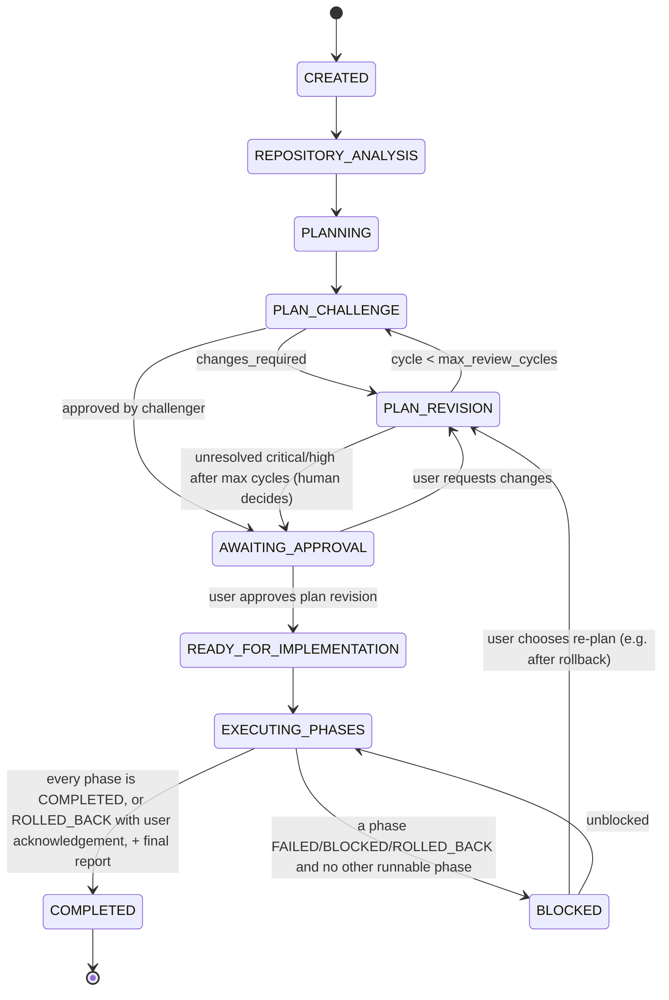

# Workflow State Machine

Status: Phase 0, revision 2 (after Codex review round 1) · 2026-10-22

ATLAS has **two** state machines:
- the **Task FSM**, which takes a request to an approved plan and then to completion;
- the **Phase FSM**, which takes one mergeable increment from implementation to a recorded checkpoint.

The brief's single state list is split between them, because a task owns many phases, each with its own lifecycle. Phase 0 adds `AWAITING_MANUAL` and `AWAITING_APPROVAL`, which keep "blocked by a person" separate from "blocked by a fault". It also adds `MERGE_PENDING_REMOTE` and `ROLLED_BACK`, explained below.

## 0. Candidates: what evidence is bound to (core invariant)

All evidence is bound to an **immutable candidate commit**, never to uncommitted worktree state (ATLAS-001).

- After an agent finishes writing, ATLAS (not the agent) runs the diff guards and creates a **local candidate commit** on the phase branch (`git add -A` + commit, with hooks disabled; see github-integration.md §2). The result is `candidate(phase_id, revision=n, commit_sha, tree_sha)`.
- Tests, code review, QA, CI, approvals and merge **all reference `candidate_id`**. A gate passes only if every piece of evidence it needs refers to the **current** candidate.
- Any further change creates a new candidate (`revision n+1`). Changes include a fix, a rebase onto a new base, or a conflict resolution. **All evidence and approvals for older revisions become stale and must be re-obtained.** Unresolved findings carry forward by fingerprint.
- After an agent run, ATLAS checks that the worktree at the candidate is clean (`git status --porcelain --untracked-files=all` empty). Any change outside a recorded candidate blocks progress.
- **Evidence-producing runs never execute in the developer worktree.** Each test run, and each QA handoff, gets a fresh **detached verification worktree** at the candidate commit (`git worktree add --detach`). ATLAS checks **source integrity** before and after the run (ATLAS-001 r2, ATLAS-101):
  - before: `HEAD == candidate.commit_sha` and status clean;
  - after: `HEAD` unchanged, `git diff --quiet <candidate>` passes, and no untracked non-ignored files exist.

  Ignored paths (build output, caches, reports written to the sandbox output dir) are allowed to change. If the run mutated source, its evidence is recorded as `invalid_source_mutated` and **never** satisfies a gate. The verification worktree is then discarded.
- **Protected-path changes (ATLAS-102, ATLAS-201):** the candidate is created *before* any approval exists. Diff guards record the **complete set of violations** in `candidate_guard_violations`, one row per violation: kind ∈ {`protected_path`, `secret_change`, `destructive_migration`}, plus path and detail. A candidate with any violation is `held`. It cannot enter TESTING or delivery until **every violation kind present** has its own approved approval bound to **that candidate_id** and the current policy_version. One approval kind never covers another. The same check runs again at G-MERGE-PRE.
- The commit pushed to GitHub is the candidate commit itself, not a re-commit. Its SHA can be compared directly with the PR head and the merged head.

## 1. Task FSM



Overlay states, reachable from any non-terminal state:
- `PAUSED`: stores `resume_to`, the state to return to.
- `CANCELLED`: terminal.
- `FAILED`: terminal; requires user confirmation or an unrecoverable error.

**Plan approval:** by default, a human approves the plan before implementation (`execution.mode: supervised`). In `autonomous` mode, a challenger "approved" verdict with no open critical or high findings auto-advances. An unresolved critical or high finding always goes to a human. A re-plan creates a new plan revision. Phases already COMPLETED are kept, and phases not yet started are superseded.

**Task completion with rollback (ATLAS-018):** a ROLLED_BACK phase lets the task complete only if the user acknowledges it. The final report states which phases were rolled back. Phases depending on a ROLLED_BACK phase go to `BLOCKED(reason=dependency_rolled_back)` and need re-planning or cancellation.

## 2. Phase FSM

```mermaid
stateDiagram-v2
  [*] --> PENDING
  PENDING --> READY: G-DEP
  READY --> PREPARING_WORKSPACE: acquire repo lock
  PREPARING_WORKSPACE --> IMPLEMENTING: G-WS
  IMPLEMENTING --> CANDIDATE_CREATED: G-CAND (diff guards + candidate commit r1)
  CANDIDATE_CREATED --> TESTING: G-DIFF
  CANDIDATE_CREATED --> AWAITING_APPROVAL: candidate held (protected path / secrets / destructive migration)
  AWAITING_APPROVAL --> TESTING: approval bound to this candidate
  TESTING --> CODE_REVIEW: G-TEST
  TESTING --> FIXING: tests fail, repairs < max
  CODE_REVIEW --> FIXING: blocking findings
  CODE_REVIEW --> QA_REVIEW: G-REV
  QA_REVIEW --> AWAITING_MANUAL: QA agent is manual
  AWAITING_MANUAL --> QA_REVIEW: result imported + validated
  QA_REVIEW --> FIXING: changes_required / blocking QA findings
  QA_REVIEW --> READY_FOR_DELIVERY: G-QA
  FIXING --> CANDIDATE_CREATED: new revision (evidence for old revision now stale)
  READY_FOR_DELIVERY --> PUSHED: G-PUSH (outbox push of candidate sha)
  PUSHED --> PR_OPEN: G-PR (create once; later revisions update the same PR)
  PR_OPEN --> CI_VALIDATION
  CI_VALIDATION --> FIXING: checks failed (phase-caused)
  CI_VALIDATION --> CANDIDATE_CREATED: BEHIND/conflict → rebase creates new revision
  CI_VALIDATION --> AWAITING_APPROVAL: G-CI and merge needs human approval
  CI_VALIDATION --> MERGING: G-CI + G-MERGE-PRE and auto_merge on
  AWAITING_APPROVAL --> MERGING: approval for this candidate + G-MERGE-PRE
  AWAITING_APPROVAL --> CI_VALIDATION: approval stale (candidate/policy changed or expired)
  MERGING --> MERGE_PENDING_REMOTE: GitHub queued / auto-merge armed
  MERGE_PENDING_REMOTE --> MERGED: G-MERGED
  MERGE_PENDING_REMOTE --> CI_VALIDATION: dequeued / auto-merge cancelled / head changed
  MERGE_PENDING_REMOTE --> CANCELLING_REMOTE_MERGE: authorisation no longer valid (approval expired/revoked, policy changed, auto_merge disabled, gate fails)
  CANCELLING_REMOTE_MERGE --> CI_VALIDATION: cancellation confirmed (remote no longer queued/armed)
  CANCELLING_REMOTE_MERGE --> MERGED: GitHub merged before cancellation took effect → G-MERGED + BLOCKED(merged_after_authorisation_lapsed) for user review
  MERGING --> MERGED: G-MERGED
  MERGING --> BLOCKED: merged head ≠ candidate (external_merge_mismatch)
  MERGED --> POST_MERGE_VERIFICATION
  POST_MERGE_VERIFICATION --> COMPLETED: base CI green (or verification disabled)
  POST_MERGE_VERIFICATION --> ROLLBACK_PROPOSED: base CI red
  ROLLBACK_PROPOSED --> COMPLETED: user declines rollback (recorded)
  ROLLBACK_PROPOSED --> ROLLBACK_IN_PROGRESS: user approves → revert phase created
  ROLLBACK_IN_PROGRESS --> ROLLED_BACK: revert phase COMPLETED
  ROLLBACK_IN_PROGRESS --> BLOCKED: revert phase FAILED/BLOCKED
  COMPLETED --> [*]
  ROLLED_BACK --> [*]
```



A revert is delivered as a new phase with `kind=revert` and `reverts_phase_id`. It runs the full pipeline. The original phase goes from `ROLLBACK_IN_PROGRESS` to `ROLLED_BACK` once the revert phase is COMPLETED.

Overlay states, reachable from any non-terminal phase state:

| State | Meaning | Exit |
|---|---|---|
| `PAUSED` | User or capacity pause. `resume_to` is stored. **Pausing withdraws merge authorisation:** pausing a phase in MERGE_PENDING_REMOTE or CANCELLING_REMOTE_MERGE first completes `cancel_remote_merge` and confirms it. Only then is PAUSED entered, with `resume_to=CI_VALIDATION`. A paused phase never has a live remote merge request (ATLAS-008 r4). If the withdrawal can't be confirmed, the phase goes to BLOCKED(remote_merge_not_withdrawn) | Resume → `resume_to`, after recovery reconciliation and guard re-check |
| `BLOCKED` | A gate cannot be satisfied. `blocked_reason` is stored | User action → a state chosen from an allowlist per reason |
| `AWAITING_MANUAL` | A manual step is outstanding (Antigravity handoff) | Valid import |
| `AWAITING_APPROVAL` | Human approval is required (plan, merge, waiver, protected-path change). The pending `approvals.kind` determines the only allowed exit: `protected_path`/`destructive_migration`/`secret_change` → TESTING, `merge` → MERGING | Approve (kind-specific target) or reject (→ BLOCKED or FIXING, user's choice) |
| `FAILED` | Terminal. The branch is kept and dependents are BLOCKED | — |
| `CANCELLED` | Terminal. Any open PR is closed through the outbox, with the user's confirmation | — |

Mapping to the brief's states:
- `PLAN_*`, `REPOSITORY_ANALYSIS` and `PLANNING` live in the Task FSM.
- `READY_FOR_COMMIT` and `COMMITTED` are replaced by `CANDIDATE_CREATED` (the commit happens before testing) and `READY_FOR_DELIVERY`.
- `PUSHING` is an outbox op in flight, not an FSM state.
- `DEPLOYMENT_VERIFICATION` is `POST_MERGE_VERIFICATION`.

## 3. Transition rules

A transition is a row in `transitions` with these fields: `from`, `to`, `reason`, `actor` (`orchestrator` | `user:<id>` | `recovery`), `candidate_id`, `evidence_refs[]`, `policy_version`, `correlation_id` and `at`. It is applied in one transaction:

```
BEGIN IMMEDIATE;
  SELECT state, version, current_candidate_id FROM phases WHERE id=? ;
  assert (state, to) in ALLOWED and guard(phase, candidate, evidence, policy) is True
  UPDATE phases SET state=?, version=version+1 WHERE id=? AND version=?;
  INSERT INTO transitions(...);
  INSERT INTO checkpoints(...)  -- when the target is a checkpoint state
COMMIT;
```

An invalid `(from, to)` pair raises `InvalidTransition`, which is logged and not retried. A stale version raises `ConcurrentModification`.

### 3.1 Guards (policy engine)

"Current candidate" means `phases.current_candidate_id`. Every guard that needs evidence requires that evidence's `candidate_id` to equal it.

| ID | Transition | Guard |
|---|---|---|
| G-DEP | PENDING→READY | All dependencies are COMPLETED, the project is not PAUSED, and the repo lock is available for the **repository** (not the project) |
| G-WS | PREPARING_WORKSPACE→IMPLEMENTING | Worktree on its `atlas/...` branch, `HEAD == base_sha` (freshly fetched), tree clean, repo lock held |
| G-CAP | → any agent-running state | Assigned agent capacity is AVAILABLE (or UNKNOWN with backoff elapsed) and has the required capability |
| G-IND | assigning review/QA/challenge | Reviewer provider ≠ author provider and model family ≠ author family (ADR-005) |
| G-CAND | IMPLEMENTING/FIXING→CANDIDATE_CREATED | The agent execution ended (exit 0 and parsed result) and its process group is confirmed gone. Candidate commit created, the worktree is clean afterwards, and diff guards evaluated → `guard_status` recorded |
| G-DIFF | CANDIDATE_CREATED→TESTING (and AWAITING_APPROVAL→TESTING) | No rows in `candidate_guard_violations`, **or** for every distinct violation kind on this candidate there is an approved approval of **that same kind**, with this `candidate_id`, the current `policy_version`, and not expired (ATLAS-201) |
| G-TEST | TESTING→CODE_REVIEW | Every required test command has an `executed` test_run for the current candidate with exit 0 **and `integrity=verified`** (source unchanged before and after, §0). The required set is non-empty when `require_tests` |
| G-REV | CODE_REVIEW→QA_REVIEW | A code review exists for the current candidate. No open CRITICAL findings (or HIGH, when `block_on_high_findings`) from **any** source, unless waived by a user approval bound to this candidate |
| G-FIX | resolving a finding | `verified_fixed` requires an independent reviewer's re-check on a candidate newer than the one the finding was raised on, plus G-TEST on that candidate. The developer's claim counts only as `agent_reported` |
| G-QA | QA_REVIEW→READY_FOR_DELIVERY | The QA result is for the current candidate, and its verification worktree passed the source-integrity check (§0). It covers **every** acceptance-criterion ID of the phase exactly once, and every mandatory criterion is `met`. Its verdict is `pass` and consistent: no `not_met` mandatory criterion and no blocking findings. Blocking findings across review **and** QA are all resolved or waived. Otherwise a user waiver bound to this candidate, when `require_independent_qa: false` (ATLAS-015) |
| G-PUSH | READY_FOR_DELIVERY→PUSHED | Outbox push confirmed: `ls-remote` branch == candidate commit SHA |
| G-PR | PUSHED→PR_OPEN | The phase's single PR exists (created once, found by marker), and PR `headRefOid` == candidate commit SHA |
| G-CI | CI_VALIDATION→AWAITING_APPROVAL/MERGING | Branch protection is **known** (or the project config gives an explicit trusted required-check list). Every required check is present and `SUCCESS` on the candidate SHA. `reviewDecision` satisfies the known review requirement. `mergeable=MERGEABLE`. Blocking findings are clear (re-evaluated, ATLAS-015). If protection is unknown and no explicit list exists, automated merge is impossible and the phase waits for the user, who may merge in GitHub themselves (ATLAS-010) |
| G-MERGE-PRE | every entry to MERGING, **again immediately before the merge op executes**, and **on every poll while MERGE_PENDING_REMOTE** | All of G-CI and G-DIFF re-evaluated **now** against fresh `gh` data. The repo lock is held. A merge authorisation exists: either `auto_merge: true` in the current policy version, or an `approvals` row with kind=merge, status=approved, the same `candidate_id`, the same `policy_version` and an unexpired `expires_at` (ATLAS-007) |
| G-MERGED | →MERGED | `gh pr view` shows `state=MERGED`. `headRefOid` at merge == candidate commit SHA, the base matches, and the repo matches. `mergeCommit.oid` is recorded and reachable from `origin/<base>`. A mismatch goes to `BLOCKED(external_merge_mismatch)` and is never treated as gated delivery (ATLAS-009) |
| G-RETRY | any retry | `retry_count < limit`, the operation is idempotent or reconciled, and capacity allows it |

### 3.2 Repair budget
- Test, CI and QA failures share the `max_repair_attempts` budget, which defaults to 3 per phase.
- Review cycles are capped at `max_review_cycles`, which defaults to 3.
- When either budget is exhausted, the phase goes to `BLOCKED(repair_budget_exhausted)`.
- Partial work is never merged.

### 3.3 Checkpoint states
A checkpoint is written on entry to:
- READY and IMPLEMENTING;
- CANDIDATE_CREATED, TESTING (done), CODE_REVIEW (done) and QA_REVIEW (done);
- READY_FOR_DELIVERY, PUSHED and PR_OPEN;
- MERGE_PENDING_REMOTE and MERGED;
- COMPLETED and ROLLED_BACK;
- every PAUSED, BLOCKED and AWAITING_* state.

## 4. Execution record
`executions` rows have these fields:
- `id`, `project_id`, `task_id`, `phase_id`, `candidate_id`;
- `kind`, `agent`, `role`, `model`;
- `status` (`launching|running|succeeded|failed|timed_out|cancelled|interrupted|awaiting_manual`);
- `retry_count`, input/output artefacts, `git_sha`;
- launch-handshake fields (see recovery-strategy.md §2);
- `exit_code`, `error_class`, `error_detail`, `capacity_signal`, `correlation_id`.

## 5. Tests required (Phase 1)
- Table-driven tests: every `(from, to)` pair not in `ALLOWED` raises an error.
- A Hypothesis stateful test asserting that:
  - MERGED is never reached without G-TEST, G-REV, G-QA and G-CI evidence **for the same candidate as the merged head**;
  - creating a new candidate makes every earlier piece of evidence stale.
- Concurrency: two writers race on one phase, and exactly one wins.
- Approval staleness: an approval for candidate r1 cannot authorise a merge of r2, nor one made after a policy-version change or after expiry.
